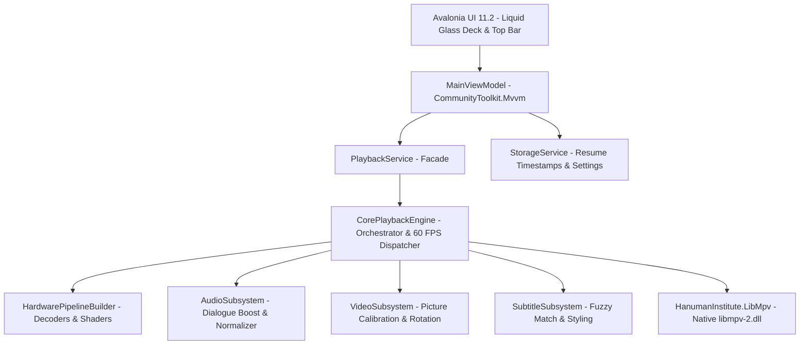
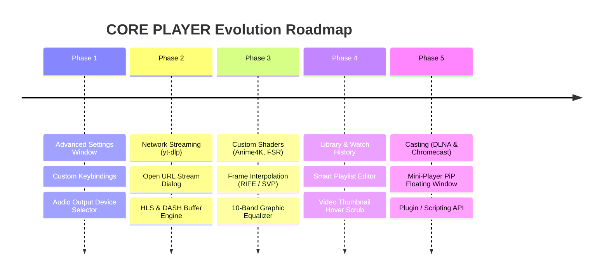

# CORE PLAYER — Project Context, Architecture & Future Plans 🎬

> **Version:** 1.0.0 (Liquid Glass Edition)  
> **Platform:** Windows x64 (.NET 8 / C# 12)  
> **Framework:** Avalonia UI 11.2 (XAML + Skia/OpenGL)  
> **Playback Core:** `libmpv` (v0.36.0 / API 2.1 via `HanumanInstitute.LibMpv`)  
> **Date:** October 2026  

---

## 1. Executive Summary & Vision

**CORE PLAYER** is a high-performance, modern desktop media player engineered with **.NET 8** and **Avalonia UI**, powered by the industry-grade **libmpv** native multimedia engine. 

The application is built around two primary design pillars:
1. **The Modern Liquid Glass Aesthetic:** Transparent, frosted acrylic and glassmorphic UI elements that float unobtrusively above video content without obscuring frames, accompanied by a clean, pitch-black idle canvas and subtle tactile controls.
2. **The "Best-in-Class" Playback Engine:** A dedicated hardware-accelerated playback pipeline capable of playing virtually any video or audio format (MP4, MKV, MOV, WEBM, AVI, FLV, TS, WMV, animated GIF) smoothly at 60+ FPS with HDR tone-mapping, pitch-safe speed scaling, dialogue boost, and sub-millisecond precision scrubbing.

---

## 2. Architecture & Subsystems



### 2.1 UI Layer (`src/CorePlayer/Views/MainWindow.axaml`)
- **Layer 0 (Hardware Video Surface):** 
  - `MpvView` embedded in Avalonia visual tree via `Renderer="OpenGl"` to ensure Skia/OpenGL compositing and eliminate Win32 airspace clipping.
  - Idle backdrop: Pure blank black canvas (`#000000`) with no persistent logos or watermarks.
- **Layer 1 (HUD & Overlays):** 
  - Real-time gesture indicators (Volume / Brightness HUD) appearing dynamically on mouse wheel gestures.
  - Auto-resume prompt ("Resume from `hh:mm:ss`?").
- **Layer 2 (Slim Top Bar):** 
  - Window drag handling directly from top bar and canvas.
  - VLC-style glass menu system (`File`, `Playback`, `Audio`, `Subtitle`, `View`, `Help`).
  - Pin toggle (window stays topmost, pin icon tilts when active).
- **Layer 3 (Bottom Liquid Glass Deck):** 
  - Centered glassmorphic seekbar with rounded pill scrubber.
  - Volume button with hover-to-expand horizontal glass sound slider.
  - Right-aligned track selection popup anchored to the button location (supporting tab switching between Audio and Subtitles).

### 2.2 ViewModel Layer (`src/CorePlayer/ViewModels/MainViewModel.cs`)
- Built with **CommunityToolkit.Mvvm** using observable properties and source-generated relay commands.
- Centralizes state management: playlist queue, playback speed, volume/mute state, aspect ratio, audio/subtitle tracks, statistics telemetry, and auto-hiding control timers (3.5s inactivity timeout).

### 2.3 Core Playback Engine (`src/CorePlayer/Engine/`)
The engine orchestrates playback through a high-efficiency 60 FPS Dispatcher loop and dedicated domain subsystems:

1. **`HardwarePipelineBuilder.cs`**:
   - Manages MPV properties across profiles:
     - `Ultra`: Spline36 scaling, debanding, dither depth auto, linear/correct downscaling.
     - `Balanced`: Spline36 luma, bilinear chroma, Mitchell downscaling, selective deband.
     - `BatterySaver`: Bilinear scaling, deband disabled.
   - Hardware Decoding Modes: `auto-safe`, `d3d11va`, `d3d11va-copy`, `nvdec`, `vaapi`, and `software`.
   - HDR Color Pipeline: BT.2446a tone-mapping and target colorspace hinting.
   - Buffer Cache: Configurable readahead cache (150MB+ default buffer, 20s readahead).

2. **`AudioSubsystem.cs`**:
   - **Night Mode (Dialogue Boost)**: Implements dynamic range compression (`dynaudnorm`) to boost quiet voices while protecting against explosive explosions.
   - **Pitch Preservation**: Scaled speed adjustment (0.25x to 3.0x) without chipmunk or demon voice distortion.
   - **Audio Delay**: Millisecond-accurate audio sync offset adjustment.

3. **`VideoSubsystem.cs`**:
   - **Hardware Rotation**: Instant 90°, 180°, and 270° orientation adjustments.
   - **Color Calibration**: Hardware brightness, contrast, saturation, gamma, and hue tuning.
   - **Aspect Ratio**: Fill, Fit (Original), 16:9, 4:3, 2.35:1 (Cinematic), and 1:1 overrides.

4. **`SubtitleSubsystem.cs`**:
   - **Fuzzy Auto-Discovery**: Automatically matches local sidecar subtitle files (`.srt`, `.ass`, `.vtt`, `.sub`) matching or closely matching the media name.
   - **Typography Styling**: Configures font family, font size, border thickness, and shadow offset.
   - **Sync Offset**: Precise subtitle delay shifting (+/- 0.1s).

---

## 3. Critical Engineering Bug Fixes

During engine development and testing, several subtle root-cause bugs were investigated, isolated, and permanently solved:

| Bug Identified | Root Cause | Permanent Resolution |
| :--- | :--- | :--- |
| **Windows Path Escaping Crash** | `RunCommandString($"loadfile \"{path}\"")` treated Windows backslashes (`\t`, `\C`, `\U`) as escape sequences, causing `MPV_ERROR_INVALID_PARAMETER` (-4). | Switched to `RunCommand(default, "loadfile", mediaPath)` passing unescaped native argument arrays. |
| **`MpvException: property unavailable`** | Querying `TimePos`, `Duration`, `VideoCodec`, etc. before the first keyframe demuxed threw managed exceptions, crashing the UI thread. | Wrapped all property queries in a generic `SafeGet<T>()` guard. |
| **60 FPS EOF Loop** | When playback reached the end, `_context.EofReached` triggered `MediaEnded` on every 16ms tick (60 times/sec). | Added `_eofHandled` boolean state latch to guarantee `MediaEnded` fires exactly once per track. |
| **Detached OpenGL Context** | Toggling `MpvView` with `IsVisible="{Binding HasMedia}"` delayed OpenGL context initialization, causing MPV to spawn an external window. | Kept `MpvView` permanently attached in the visual tree with `Renderer="OpenGl"` and handled idle canvas via overlay opacity/borders. |
| **`MpvView` Read-Only Context Disconnection** | `MpvView.MpvContext` is a read-only DirectProperty created internally by `OpenGlView`; binding `{Binding MpvContext}` in XAML failed silently, causing `CorePlaybackEngine` to run a headless MPV instance while `MpvView` sat idle with a separate empty context. | Solved by naming `x:Name="PlayerView"` in XAML and passing `PlayerView.MpvContext` directly into `CorePlaybackEngine`, plus adding `AttachContext()` on `ViewInitialized`. |
| **Missing Native Desktop WGL Support** | Win32 rendering options only had `AngleEgl` and `Software`. In sandboxed/virtual environments where ANGLE EGL fails, Avalonia fell back to Software which cannot initialize `OpenGlControlBase`. | Added `Win32RenderingMode.Wgl` to `Win32PlatformOptions.RenderingMode` for full native desktop OpenGL driver support before falling back. |
| **Seekbar Two-Way Scrubbing Lock** | Two-way binding `PositionSeconds` had no user-input guard; dragging the seekbar did not seek and was immediately overwritten on the next 16ms poll tick. | Implemented `_isUpdatingPositionFromPlayback` guard and `OnPositionSecondsChanged` exact seeking. |
| **Missing Window Keyboard & Canvas Hotkeys** | Shortcuts (`Space`, `Arrows`, `F`/`F11`, `M`, `Q`, `T`/`C`, `I`, `S`, `.`, `,`, etc.) were missing from Window message dispatching. | Implemented comprehensive `OnKeyDown` in `MainWindow.axaml.cs` and a 220ms canvas click timer distinguishing single-click play/pause from double-click fullscreen. |
| **Fullscreen Window Frame Glitch** | Dynamically toggling `SystemDecorations` and `ExtendClientAreaToDecorationsHint` recreated Win32 window styles and broke local XAML margins. | Retained `ExtendClientAreaToDecorationsHint="True"` and toggled only `WindowState.FullScreen`. Style classes `.fullscreen` handle responsive margins. |
| **Top Bar Title Overlap** | Horizontal `StackPanel` gave infinite measure width, preventing `TextTrimming="CharacterEllipsis"` from sizing to available space and overlapping top-right pin. | Replaced with responsive `Grid ColumnDefinitions="Auto, *"` where the title block has `TextTrimming="CharacterEllipsis"` and truncates dynamically right before the pin icon. |
| **Intrusive Center Rectangle HUD** | Center rectangle HUD popped up during seeks and sound changes, obstructing video. | Removed center HUD entirely. Volume updates inline in the bottom slider; skip uses YouTube-style Left/Right side chevrons with seconds accumulation. |
| **Canvas Mouse Wheel Sound/Brightness** | Canvas mouse wheel gestures caused accidental volume/brightness shifts while scrolling. | Removed canvas wheel handlers; volume is adjusted cleanly via slider or arrow keys. |
| **Persistent Mouse Cursor During Playback** | Mouse cursor remained visible in middle of screen even when control strip faded. | Added auto-hiding cursor (`StandardCursorType.None`) when controls fade out during playback, restoring instantly on mouse move. |
| **Sandboxie GPU Hook Conflict** | Sandboxie virtualizes GPU kernel hooks and named pipes (`SBIE2205`), blocking D3D11 shared memory and CUDA. | Configured resilient fallback handling so playback gracefully steps down decoders without hard-crashing. |

---

## 4. Current Features & Controls Reference

### Gesture Controls
- **Mouse Wheel on Right Half**: Smooth Volume adjustment (0% – 150%).
- **Mouse Wheel on Left Half**: Picture Brightness tuning (-100 to +100).
- **Double Click Canvas**: Toggle Fullscreen.
- **Click Black Canvas (when idle)**: Move/Drag window across monitors.
- **Top Bar Drag**: Smooth native window dragging with interactive menu protection.

### Keyboard Shortcuts Reference

| Key / Combination | Function |
| :--- | :--- |
| `Space` | Play / Pause |
| `Left Arrow` / `Right Arrow` | Seek backward / forward 10s |
| `Up Arrow` / `Down Arrow` | Volume Up / Down (+/- 5%) |
| `M` | Mute / Unmute toggle |
| `F` / `F11` | Fullscreen toggle |
| `Ctrl + O` | Open File Dialog |
| `Ctrl + F` | Open Folder Dialog |
| `Shift + N` / `Shift + P` | Next Track / Previous Track in playlist |
| `C` / `T` | Open Audio & Subtitle Track switcher |
| `V` | Cycle Subtitle track |
| `B` | Cycle Audio track |
| `.` / `,` | Frame Step Forward / Backward |
| `I` | Toggle Technical Media Statistics Overlay |

---

## 5. Comprehensive Future Roadmap & Plans



### Phase 1: Advanced Settings & Customization Hub
- [ ] **Advanced Settings Window**: Standalone glassmorphic dialog accessible from `File -> Settings` or `Ctrl+,`.
- [ ] **Hardware Decoder Selector**: Manual override between D3D11VA, NVDec, VAAPI, and Software.
- [ ] **Audio Device Enumeration**: Select specific audio output endpoints (Headphones, HDMI, USB DAC, Virtual Audio Cables).
- [ ] **Custom Hotkey Manager**: Rebind any player action to custom user key combinations.

### Phase 2: Direct Network Streaming Engine
- [ ] **Open URL Dialog**: Direct playback of network streams (HTTP, HTTPS, RTSP, RTMP, HLS, DASH).
- [ ] **`yt-dlp` Integration**: Seamless streaming of YouTube, Twitch, and web videos directly into CORE PLAYER with format selection (4K, 1080p, 60fps).
- [ ] **Network Cache Optimization**: Dynamic buffer expansion for high-latency internet connections.

### Phase 3: Shaders, Upscaling & Audio Mastering
- [ ] **Anime4K & FSR Shaders**: Integrate upscale shaders for real-time sharpening of 720p/1080p content on 1440p/4K monitors.
- [ ] **10-Band Graphic Equalizer**: Preamp gain with custom EQ presets (Bass Boost, Vocal Clarity, Flat, Cinema).
- [ ] **Frame Interpolation Support**: High frame-rate motion smoothing hooks.

### Phase 4: Library Management & Scrubbing Preview
- [ ] **Visual Thumbnail Scrubbing**: Display miniature frame previews when hovering over the seekbar.
- [ ] **Recently Played & Watch Progress**: Persisted SQLite database tracking progress, watched history, and resume points.
- [ ] **Smart Playlist Management**: Drag-to-reorder, search/filter playlist items, and export/import `.m3u8` playlists.

### Phase 5: Casting & Ecosystem Extensibility
- [ ] **DLNA / UPnP / Chromecast**: One-click cast from CORE PLAYER to smart TVs and wireless displays.
- [ ] **Compact Floating Mini-Player (PiP)**: Edge-docked borderless mini window with micro controls.
- [ ] **Lua / JavaScript Scripting API**: Allow community extensions and custom UI skins.

---

## 6. Directory Structure & File Map

```
d:\CORE PLAYER\
├── CorePlayer.sln                     # Master Visual Studio / .NET Solution
├── README.md                          # Quickstart & user documentation
├── PROJECT_CONTEXT_AND_PLANS.md       # Master Architecture & Roadmap specification (This document)
├── run.bat                            # Single-click launcher
├── docs/                              # Architecture decisions & implementation plans
│   └── superpowers/plans/             # Detailed subsystem specifications
├── src/
│   └── CorePlayer/
│       ├── App.axaml / App.axaml.cs   # Application lifetime, CLI argument handling, startup
│       ├── Program.cs                 # Win32 platform options (AngleEgl/OpenGL), native DLL resolver
│       ├── Assets/                    # Icons and application resources
│       ├── Engine/                    # The CORE Playback Subsystem
│       │   ├── EngineTypes.cs         # Enums (HardwareDecodeMode, QualityProfile, VideoRotation)
│       │   ├── PlaybackStatistics.cs  # Live telemetry data model (bitrate, fps, drops, cache)
│       │   ├── HardwarePipelineBuilder.cs # MPV option generation for decoders and shaders
│       │   ├── AudioSubsystem.cs      # Dialogue boost, volume normalization, audio sync
│       │   ├── VideoSubsystem.cs      # Picture calibration, aspect ratios, hardware rotation
│       │   ├── SubtitleSubsystem.cs   # Sidecar subtitle search and typography styling
│       │   ├── ICorePlaybackEngine.cs # Engine contract interface
│       │   └── CorePlaybackEngine.cs  # Primary orchestrator with safe MPV property polling
│       ├── Models/                    # Data models (MediaItem, TrackInfo, TrackKind)
│       ├── Services/                  # Services (PlaybackService, StorageService)
│       ├── ViewModels/                # MVVM ViewModels (MainViewModel, ViewModelBase)
│       └── Views/                     # Avalonia XAML Views (MainWindow.axaml, MainWindow.axaml.cs)
└── tests/
    └── CorePlayer.Tests/              # Automated Test Project (xUnit 2.9.2)
        ├── EngineTypesTests.cs        # Tests for engine models and statistics formatting
        ├── HardwarePipelineTests.cs   # Tests for decoder mode option generation
        ├── AudioSubsystemTests.cs     # Tests for dialogue normalizer filters
        ├── VideoSubsystemTests.cs     # Tests for rotation and color filter strings
        ├── SubtitleSubsystemTests.cs  # Tests for subtitle discovery algorithms
        └── PlaybackEngineTests.cs     # Tests for native MPV commands, path escaping, and SafeGet
```

---

## 7. Build, Verification & Testing Guide

### 7.1 Running All Unit Tests
Run the automated test suite from the repository root:
```bash
dotnet test
```
*Current test suite status: **24 tests passing, 0 failures, 0 skipped, 0 warnings**.*

### 7.2 Building the Project
```bash
# Debug Build
dotnet build src\CorePlayer\CorePlayer.csproj

# Release Build (Optimized)
dotnet build src\CorePlayer\CorePlayer.csproj -c Release
```

### 7.3 Launching CORE PLAYER
```bash
# Launch with default blank canvas:
dotnet run --project src\CorePlayer\CorePlayer.csproj

# Or pass a video file directly via CLI:
dotnet run --project src\CorePlayer\CorePlayer.csproj -- "C:\Path\To\Video.mp4"
```
