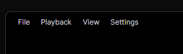
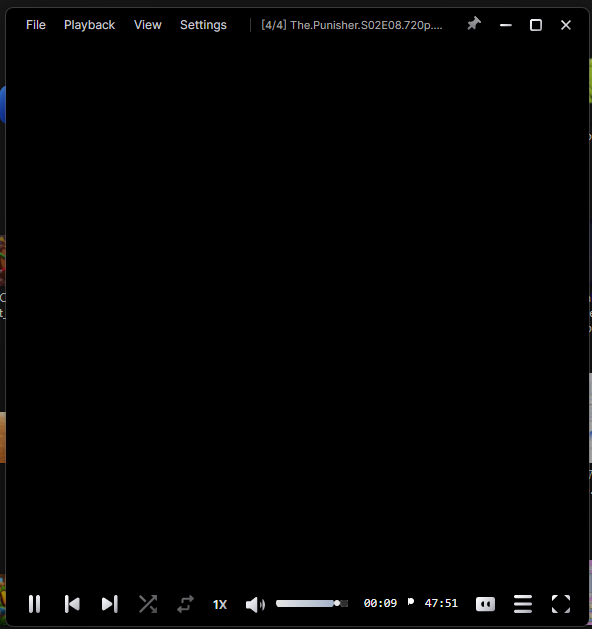

<div align="center">

# 🎬 CorePlayer

**Modern, Hardware-Accelerated Desktop Media Player for Windows**

[](https://github.com/arunmauryaz/CorePlayer/releases)
[](https://github.com/arunmauryaz/CorePlayer)
[](https://dotnet.microsoft.com/)
[](https://avaloniaui.net/)
[](https://mpv.io/)

<br/>



<br/>
<br/>

**CorePlayer** is a minimal, precision-engineered media player built with **.NET 8** and **Avalonia UI**, powered by the industry-standard **libmpv** native rendering pipeline. Engineered around a refined **Studio Obsidian & Frosted Silver** aesthetic, controls stay quietly out of your way and seamlessly vanish during playback so your content takes center stage.

</div>

---

## ⚡ Highlights

- **🚀 Native GPU Pipeline:** Powered by `libmpv` (v0.36) with Direct3D11/OpenGL hardware acceleration, rendering butter-smooth 60+ FPS playback across 4K, 8K, HDR, HEVC, AV1, and VP9.
- **🎨 Studio Obsidian Aesthetic:** Elegant deep-charcoal glass UI with clean silver typography and ice-blue precision accents—crafted to eliminate visual noise and clunky web-player clutter.
- **📱 Right-Side Slide Drawer:** Modern swipe/slide drawer for quick access to Aspect Ratios, Playback Speed presets, Video Rotation, Audio Dub tracks, and deep Settings sub-pages.
- **🔊 Auto-Hiding Interactive Volume:** The volume slider stays neatly tucked away until you hover over it or use the mouse scroll wheel.
- **🔄 Smart Seamless Resume:** Remembers your exact timestamp per video and picks up right where you left off automatically without nagging modal prompts.
- **🎛️ Dual Dubs & Subtitle Management:** Multi-language audio dub switcher, subtitle delay calibration (+/- 100ms), and drag-and-drop `.srt`/`.ass` subtitle loading.
- **🪟 Rock-Solid Fullscreen & Window Pinning:** Window controls (Minimize, Maximize/Restore, Close, and Always-on-Top Pin) stay locked in place regardless of windowed or fullscreen mode.

---

## 📸 Interface Showcase

<table width="100%">
  <tr>
    <td width="50%" align="center">
      <b>Sleek Bottom Deck & True-Center Seekbar</b><br/><br/>
      
    </td>
    <td width="50%" align="center">
      <b>Multi-Audio & Subtitle Dub Manager</b><br/><br/>
      
    </td>
  </tr>
</table>

---

## ⌨️ Keyboard & Mouse Gestures

| Gesture / Key | Action |
| :--- | :--- |
| `Space` | Play / Pause toggle |
| `Left Arrow` / `Right Arrow` | Seek backward / forward 5 seconds |
| `Shift + Left` / `Shift + Right` | Seek backward / forward 30 seconds |
| `Up Arrow` / `Down Arrow` | Volume adjust (+/- 5%) |
| `Mouse Wheel (over Volume)` | Fast volume adjust with automatic slider reveal |
| `M` | Instant Mute / Unmute toggle |
| `F` or `Double Click` | Fullscreen toggle |
| `Esc` | Exit fullscreen or close open drawer |
| `C` | Toggle Audio Streams & Subtitle Popover |
| `Shift + N` / `Shift + P` | Next / Previous item in Playlist Queue |
| `Ctrl + S` | Capture crystal-clear instant snapshot to Pictures |
| `Ctrl + O` | Open file dialog |
| `Ctrl + F` | Open folder / playlist |
| `.` / `,` | Frame step forward / backward |

---

## 📥 Download & Installation

### Option 1: Standalone Windows Package (Recommended)
Download the latest portable zip package directly from our **[Releases](https://github.com/arunmauryaz/CorePlayer/releases)**:
1. Download `CorePlayer-v1.0.0-win-x64.zip`.
2. Extract to any directory on your PC.
3. Double-click `CorePlayer.exe` to launch. *(No installation or external .NET runtimes required!)*

### Option 2: Clone & Run from Source
If you have the **.NET 8 SDK** installed:
```bash
git clone git@github.com:arunmauryaz/CorePlayer.git
cd CorePlayer
.\run.bat
```

---

## 🏗️ Architecture & Technical Specs

CorePlayer is engineered on a modular multi-tier architecture:
- **Presentation Layer:** Avalonia UI 11.2 with custom compiled XAML bindings (`AvaloniaUseCompiledBindingsByDefault`).
- **MVVM Foundation:** `CommunityToolkit.Mvvm` with decoupled commands, observables, and reactive notification handlers.
- **Engine Core:** `libmpv-2.dll` via `HanumanInstitute.LibMpv` with an asynchronous 60 FPS state sync dispatcher.
- **Hardware Pipeline:** Direct GPU decoding via `auto-safe` (D3D11VA / DXVA2 / NVDEC / VAAPI).

> 📘 *For comprehensive deep-dive architectural diagrams and engine specifications, see [`docs/PROJECT_CONTEXT_AND_PLANS.md`](docs/PROJECT_CONTEXT_AND_PLANS.md).*

---

## 🛠️ Building & Testing

To build the release binary locally:
```powershell
# Restore and build Release
dotnet build -c Release

# Execute test suite (36 unit tests)
dotnet test -c Release
```

---

## 📄 License & Credits

- Licensed under the **MIT License**.
- Media decoding powered by the [mpv player](https://mpv.io) project.
- XAML engine powered by [Avalonia UI](https://avaloniaui.net).
